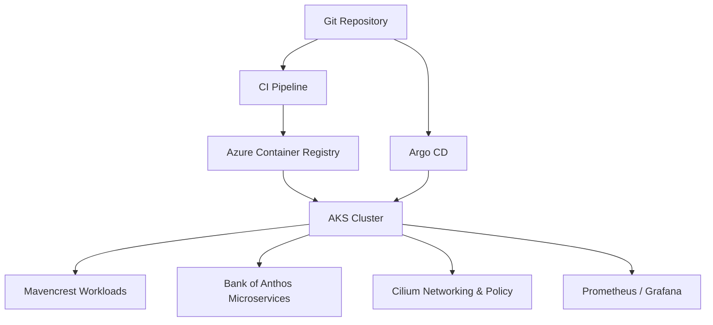
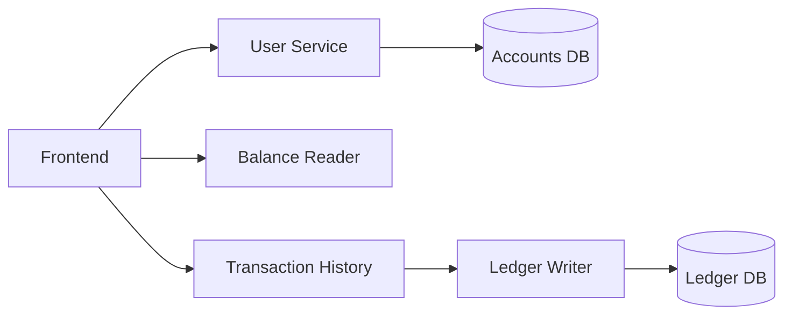
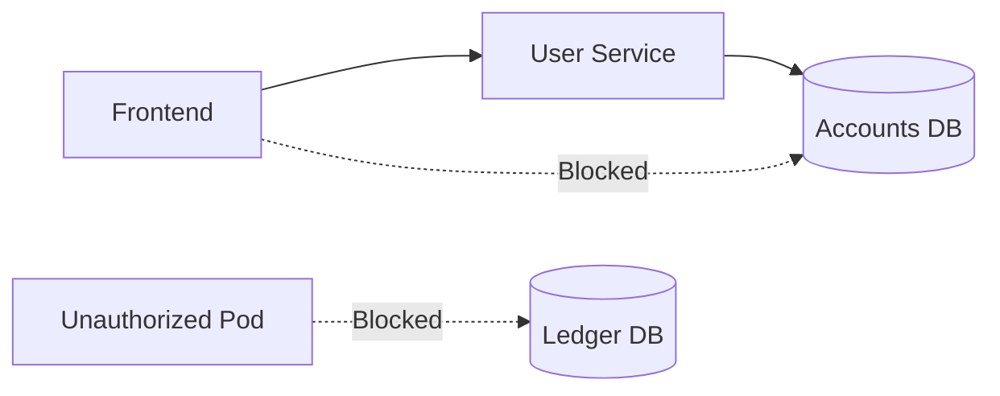
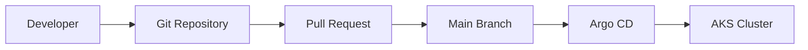

# AKS Mavencrest — Secure Microservices Platform

Azure Kubernetes Service platform built as the cloud counterpart to the Mavencrest self-managed Kubernetes environment.

The platform focuses on microservices, GitOps, autoscaling, observability, and secure workload communication using Azure-native services and Cilium-based microsegmentation.

## Architecture

## Platform Goals

- Run production-style workloads on AKS
- Host distributed microservices
- Use GitOps for controlled application delivery
- Apply Cilium-based microsegmentation
- Enable workload and node autoscaling
- Integrate Azure-native identity and secrets
- Centralize observability
- Manage infrastructure with Terraform

## Microservices

Bank of Anthos is used as the primary microservices workload.

Each service can be independently deployed, scaled, monitored, and secured.

## Secure Networking

Azure CNI with Cilium provides pod networking and policy enforcement.

A major focus is microsegmentation: services are only allowed to communicate with the workloads they require.

This reduces lateral movement and limits the blast radius of compromised workloads.

## GitOps

Argo CD keeps the AKS cluster aligned with configuration stored in Git.

## Platform Stack

| Area | Technologies |
|---|---|
| Kubernetes | AKS |
| Infrastructure | Terraform |
| Registry | Azure Container Registry |
| GitOps | Argo CD |
| Packaging | Helm |
| Networking | Azure CNI, Cilium |
| Security | NetworkPolicy, Azure RBAC, Workload Identity |
| Secrets | Azure Key Vault |
| Scaling | HPA, Cluster Autoscaler |
| Observability | Prometheus, Grafana |

## Project Objective

AKS Mavencrest demonstrates the transition from self-managed Kubernetes to a secure, scalable cloud Kubernetes platform.

The platform is designed to show how microservices can be deployed, secured, observed, and independently scaled using AKS, GitOps, and Cilium-based microsegmentation.
